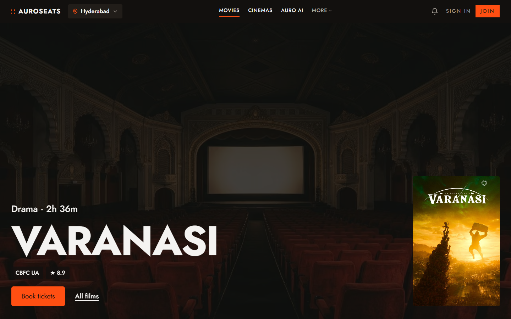
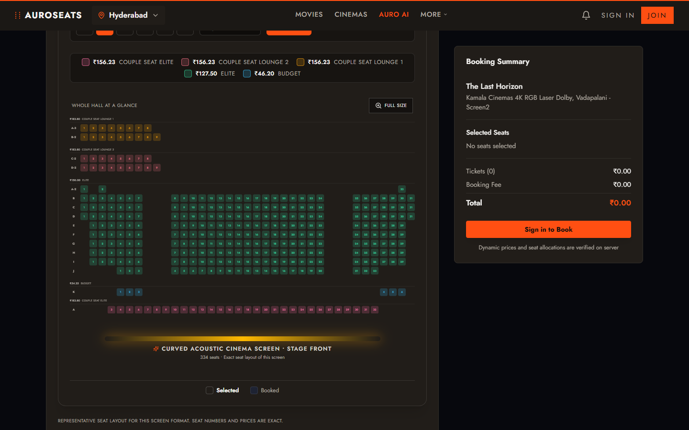
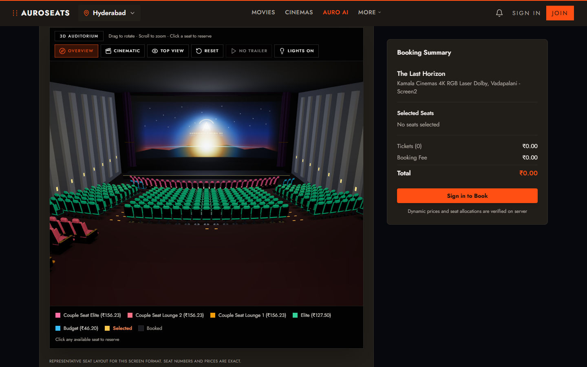
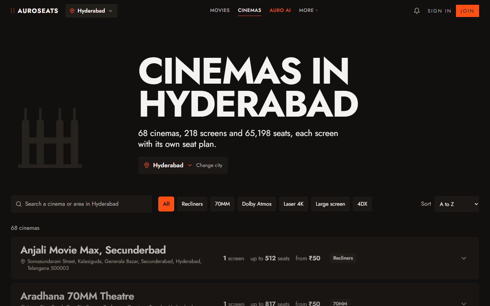
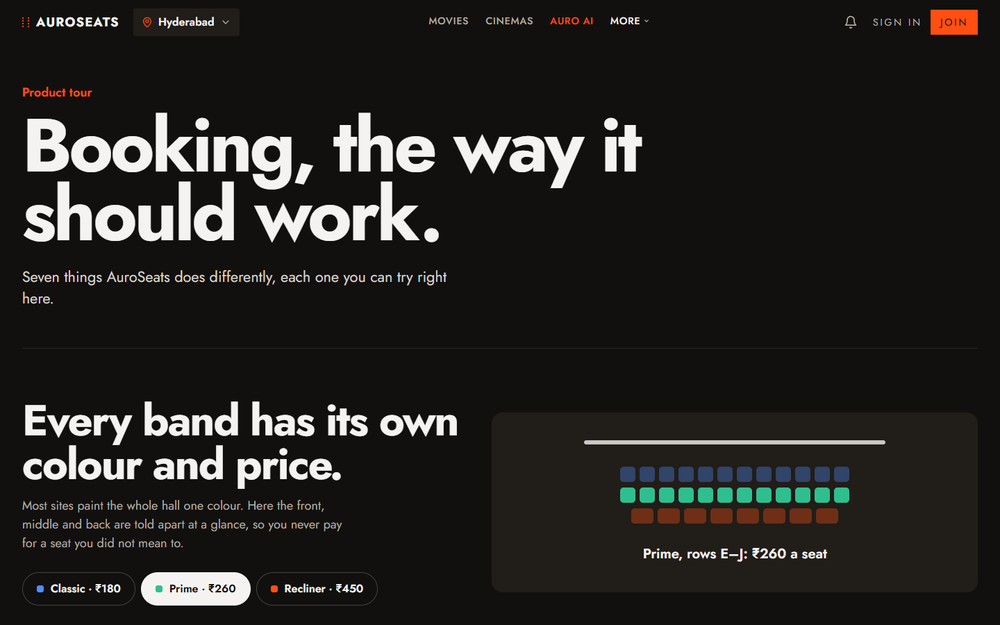
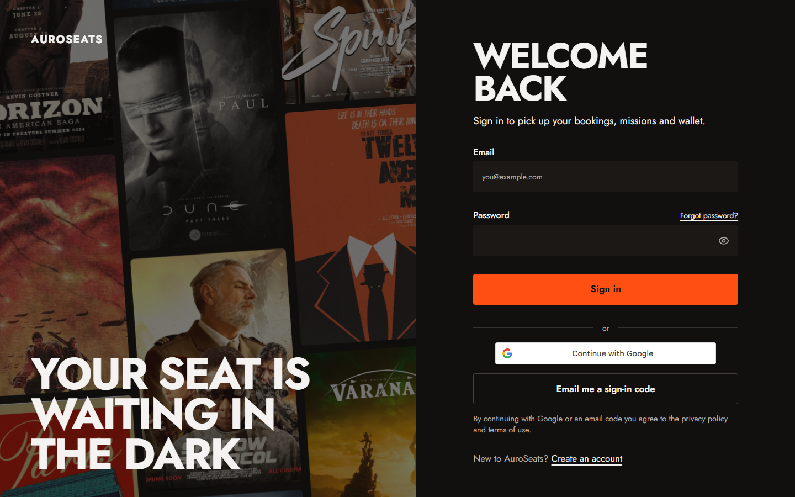
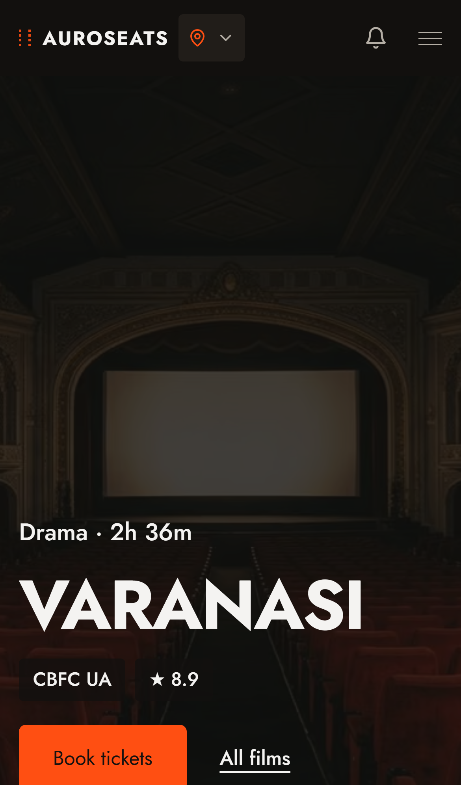
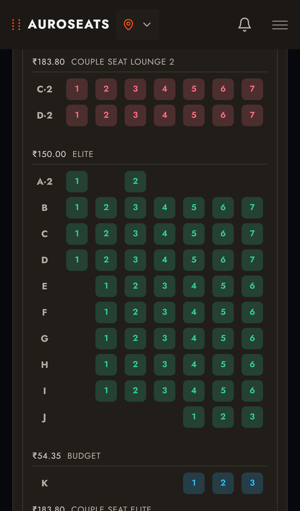
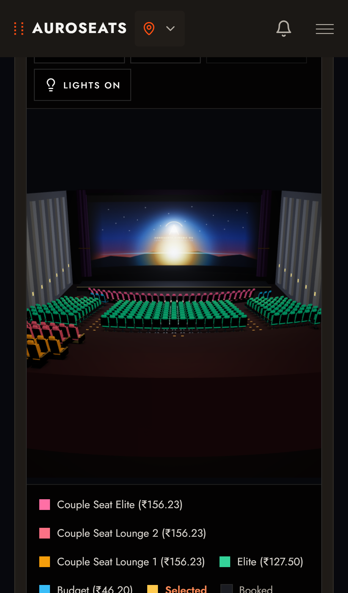
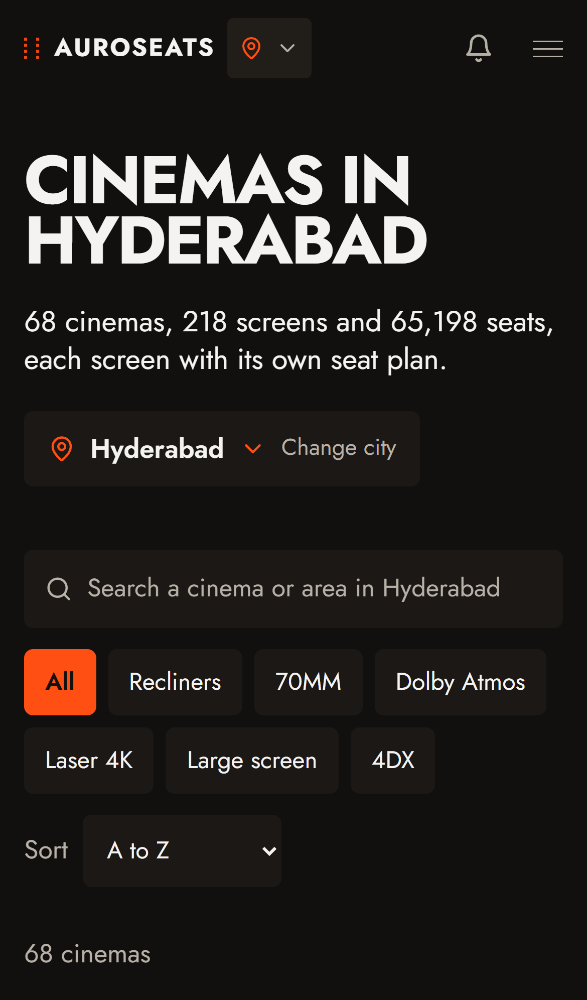

# AuroSeats

**Movie ticket booking where you pick the exact seat, from a real seat plan of the hall.**

**Live site: [www.auroseats.tech](https://www.auroseats.tech)**

> This repository is a project showcase. The source code is private and is not published here.

[Watch the full walkthrough (demo.mp4)](demo.mp4)

## What it does

- **Real seat plans.** Each screen has its own plan with the real rows, aisles and gaps, not a generic grid. 2D and 3D views show the same seats.
- **See the view before you pay.** The 3D auditorium shows the screen from the seat you pick.
- **Seat bands with their own colour and price.** The front, middle and back of a hall are easy to tell apart, so the price is clear before you tap.
- **Best seats for me.** Choose how many seats and a budget, and it picks the best side-by-side seats near the middle of the hall.
- **AutoBook.** For big first-day releases, set your seats and budget once, and the system buys them when booking opens. To keep booking fair for people booking live, AutoBook can fill at most 30% of a show, and one account can pre-book at most 10 seats for one show.
- **Auro AI assistant.** Ask in plain words (for example, two seats tonight under a budget). It looks up real shows and prices, and you confirm every seat.
- **Cinemas explorer, city pages and movie pages** with show times, filters (IMAX, Dolby Atmos, recliners and more) and one-tap seat selection.
- **Sign-in:** email and password, one-time email code, and Google sign-in.
- **Wallet** for payments and refunds.
- **Privacy built in (India DPDP Act):** consent record, data export, account deletion and a grievance form.

## Screenshots

| Home | Seat plan (2D) | 3D auditorium |
|---|---|---|
|  |  |  |

| Cinemas | Product tour | Sign in |
|---|---|---|
|  |  |  |

On a phone:

  
  
  
  

## Built with

Next.js and React with TypeScript, Supabase (Postgres, authentication and realtime), GSAP for scroll animation, Three.js for the 3D hall, deployed on Vercel. Playwright was used for browser testing on desktop and phone sizes.

## What I worked on

I designed and built the whole product: the booking flow, exact seat layouts for hundreds of screens, the 2D and 3D seat selector, the fair-booking rules, authentication, the privacy features, the design system and the performance and accessibility work.

## Status

AuroSeats is a working product demo. It is not affiliated with any cinema chain or ticketing company, and cinema listings and seat data on the site are for demonstration.

## Contact

Yashwanth: [GitHub @yashhh-max](https://github.com/yashhh-max)

## License

Copyright (c) 2026 Yashwanth. **All rights reserved.** See [LICENSE](LICENSE). The text, images and video in this repository may not be copied, reused or redistributed without written permission.
